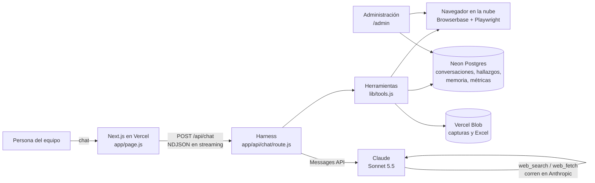

# 02 · Arquitectura del harness

"Harness" es todo lo que rodea al modelo para que cumpla su trabajo: instrucciones, herramientas, memoria, límites, seguridad, medición. El modelo (Claude) razona; el harness le da contexto, manos y reglas.

## Piezas

| Pieza | Dónde | Qué hace |
|---|---|---|
| Interfaz | `app/page.js` | Chat, historial, selector de proyecto, adjuntar capturas, descarga de Excel |
| Harness | `app/api/chat/route.js` | Arma el contexto, corre el loop del agente, ejecuta herramientas, guarda todo, mide |
| Identidad y método | `lib/knowledge.js` | Quién es el agente, cómo evalúa, cómo usa la memoria, reglas de seguridad |
| Herramientas | `lib/tools.js` | Navegador, consulta de hallazgos, registro de plataformas, memoria, Excel |
| Datos | `lib/store.js`, `db/migrations.mjs` | Todo lo que se guarda (ver [03](03-memoria-y-datos.md)) |
| Administración | `app/admin/page.js` | Estado, base, plataformas, proyectos, sesiones, evals |

## Qué pasa en una respuesta

1. **Acceso.** La cookie firmada dice quién es la persona. Se revisa su límite de uso (20 mensajes / 10 min por defecto).
2. **Conversación.** Si es nueva, se crea en la base; si no, se lee su historial (solo texto, últimos 16 turnos). El mensaje del usuario se guarda.
3. **Contexto (system prompt)**, en tres bloques, de lo más fijo a lo más variable para aprovechar el caché:
   1. Identidad + método UX + reglas de revisión en vivo (igual para todos → caché).
   2. Contexto del proyecto: cliente, sector y resultados previos (igual por proyecto → caché).
   3. Variable: plataformas registradas, índice de la memoria, persona, proyecto actual y fecha de hoy.
4. **Loop del agente** (hasta 30 vueltas o 4,5 minutos):
   - Claude responde en streaming; el texto llega al chat palabra por palabra.
   - Si pide herramientas, el harness las ejecuta y devuelve los resultados; el navegador solo se abre si hace falta.
   - `pause_turn` (búsqueda web larga) → se continúa. `refusal` → mensaje claro. `max_tokens` → aviso.
   - A los ~3 minutos, si hay revisión en vivo sin Excel, se le pide cerrar.
5. **Cierre.** Se guarda la respuesta (texto, pasos y enlace al Excel), se registran tokens, caché, herramientas usadas, duración y estado en `runs`, y se cierra el navegador.

## Decisiones técnicas y por qué

| Decisión | Por qué |
|---|---|
| **Loop propio** (no un framework) | Control total del streaming, del tiempo límite de Vercel y de la seguridad del navegador. |
| **Modelo `claude-sonnet-5-5`** (configurable con `ANTHROPIC_MODEL`) | Era el elegido por el equipo; buen balance de calidad, velocidad y costo ($2 / $10 por millón de tokens). Para entregables críticos se puede probar `claude-opus-5-5` ($4 / $20) y comparar con las evals. |
| **Razonamiento adaptativo + esfuerzo `medium`** (`AGENT_EFFORT`) | El modelo decide cuánto pensar. `high` da revisiones más profundas a mayor costo y tiempo. |
| **Historial que solo crece** (append-only) | En los modelos 5.5 el razonamiento previo queda atado al historial exacto; editarlo da error 400 en cuentas nuevas. |
| **Limpieza de resultados viejos en el servidor** (`clear_tool_uses_20250919`) | Cuando el contexto pasa de 60 mil tokens se borran los resultados de herramientas más antiguos (capturas), conservando los 6 últimos, la memoria y el Excel. Reemplaza al recorte manual. Antes de limpiar, Claude recibe un aviso para guardar en memoria lo importante. |
| **Caché del prompt y del historial** | El bloque fijo y el historial del loop se leen desde caché (~10% del precio), clave en revisiones de 20+ vueltas. |
| **Respaldo ante rechazos** (`fallbacks: "default"`) | Si el modelo rechaza un pedido por un falso positivo de seguridad, la API reintenta con otro modelo automáticamente. Se apaga con `REFUSAL_FALLBACK=off`. |
| **Historial al modelo solo en texto** | Las imágenes adjuntas y las capturas de respuestas anteriores no se reenvían: ahorra tokens y evita datos sensibles. Lo importante de cada captura queda en la "observación" y en los hallazgos guardados. |
| **Herramientas web de Anthropic** | No hay que mantener un buscador; Claude filtra resultados antes de leerlos. Se apagan con `WEB_TOOLS=off`. |

## Límites de Vercel

- La función del chat tiene `maxDuration = 300` s (máximo del plan Hobby). En **Pro con Fluid compute** se puede subir a 800 s: cambiar `maxDuration` en `app/api/chat/route.js` y ajustar `SOFT_MS` / `HARD_MS`.
- Aun así, una revisión de varias plataformas debe partirse en respuestas (una plataforma por vez) y consolidarse. Ver [05](05-como-hacer-un-benchmark.md).
